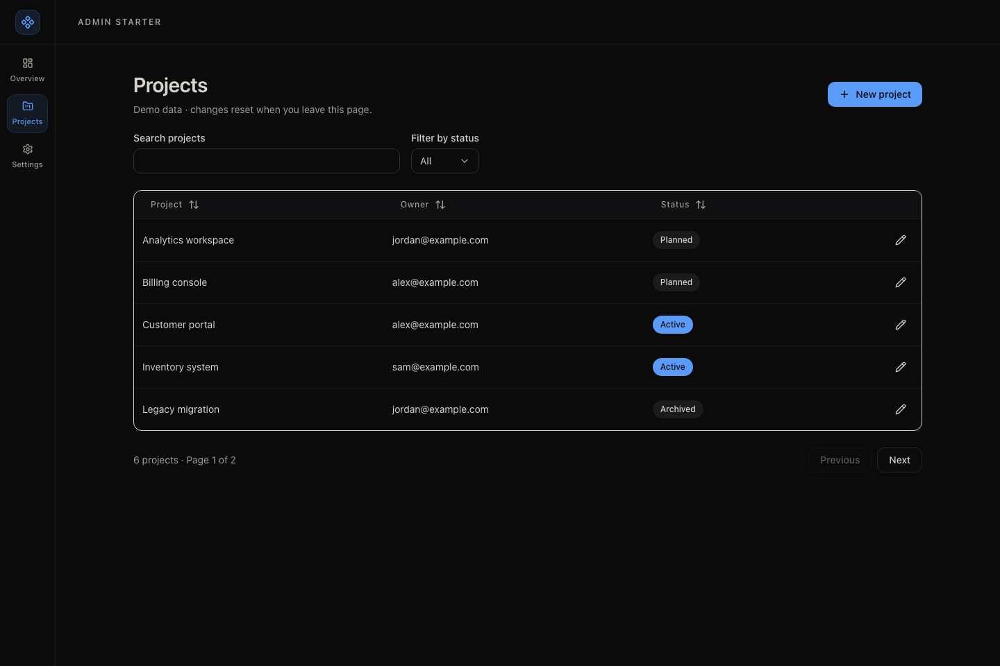

# Admin Starter

Build admin panels, dashboards, and internal tools with a compact sidebar,
reusable components, validated forms, and data tables. Built for Onyx Cloud to
select and adapt from a user's prompt.



## Start

Requires Node.js 22.18+ and npm. The UI starts without credentials or a database;
the optional Onyx example needs a downloaded database configuration.

```bash
npm ci
npm run dev -- --port 3000
```

Open [http://127.0.0.1:3000](http://127.0.0.1:3000). Use an available port for each
project. Both development and production servers bind to loopback by default.

## Make it yours

```bash
npm run template:init -- --name "Inventory Admin" --slug inventory-admin
```

This updates the display name and package namespace. Header, browser titles,
accessible home label, and `/api/health` all use `project.json`. Run this before
building; restart development after renaming. The template catalog identity stays
`admin-starter`.

## Included

- Next.js App Router, React, strict TypeScript, Tailwind, and shadcn/ui
- Radix and Lucide for accessible controls and icons
- TanStack Table, TanStack Query, React Hook Form, Zod, and nuqs
- Dark shell, sidebar navigation, loading/error boundaries, and security headers
- Working collection example: search, status filter, sort, pagination, create/edit
- Vitest, Playwright, axe accessibility checks, lint, formatting, and dead-code checks
- Agent guidance, scoped library constitutions, and feature recipes

| Route         | Purpose                                                      |
| ------------- | ------------------------------------------------------------ |
| `/`           | Living component showcase and design-system reference        |
| `/projects`   | Working demo collection; edits reset on navigation or reload |
| `/settings`   | Empty settings shell to adapt to the requested product       |
| `/api/health` | HTTP 200 with the project slug and `status: "ok"`            |

The official Onyx SDK, a Task schema, and server-only CRUD example are included.
Projects remains an in-memory UI demo. Add application authentication and
authorization before exposing private data or writes through routes.

## Onyx integration

Read [the integration guide](docs/template-integration.md). [template.json](template.json)
contains selection copy, use/avoid cases, capabilities, runtime commands, and a
preview reference. It is repository-owned metadata, not an official Onyx schema.
Onyx can cache this metadata to choose a template before installing anything.
Pin a tested commit, copy clean source, initialize the project name, then run the
standard Node.js commands on an assigned port.

## Validate and preview

```bash
npm run check       # lint, types, format, dead code, unit tests, production build
npm run check:all   # check plus desktop/mobile browser and accessibility tests
npm run template:smoke # fresh install, rename, build, start, health and route checks
npm run build
npm run start -- --port 3000
```

Browser tests start their own server on port 3217 and fail on collisions. Set
`E2E_PORT` in the process environment to run another instance. Next.js also accepts
`PORT` from the process environment; `--port` is the explicit per-instance option.
The starter runs on standard Node.js with no hosting adapter.

## Agent entry points

- [AGENTS.md](AGENTS.md) — project rules and definition of done
- [Architecture](docs/architecture/system-design.md) — runtime and ownership
- [Constitutions](docs/constitutions/index.md) — library rules, loaded as needed
- [Recipes](docs/recipes/index.md) — page, form, dialog, and table patterns
- [Contributing](CONTRIBUTING.md) — checks and commit conventions

CI runs the full quality gate, fresh-template smoke checks, and advisory npm audit.

## Onyx Database SDK

The official SDK and typed one-table Task CRUD example are included. See
[Onyx setup and example](docs/onyx.md) for downloaded configuration, explicit
schema commands, CLI CRUD, and authorization boundaries. UI startup needs no credentials.
